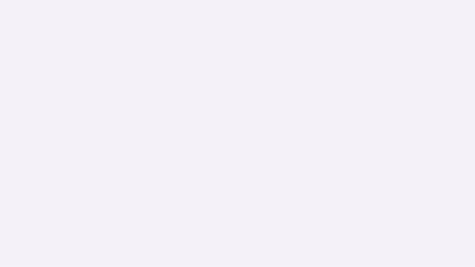
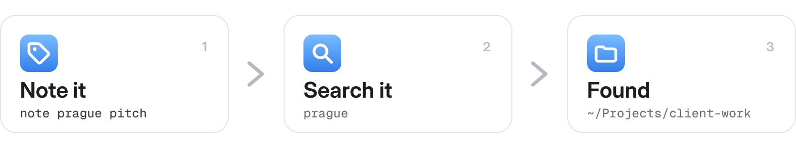
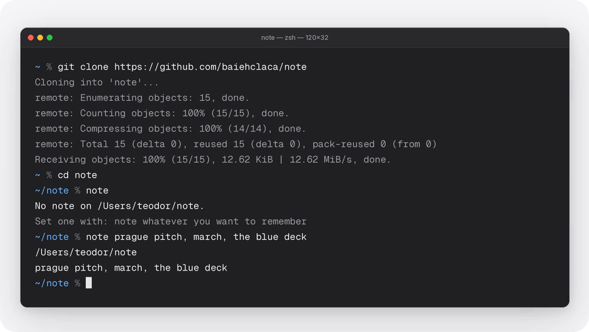
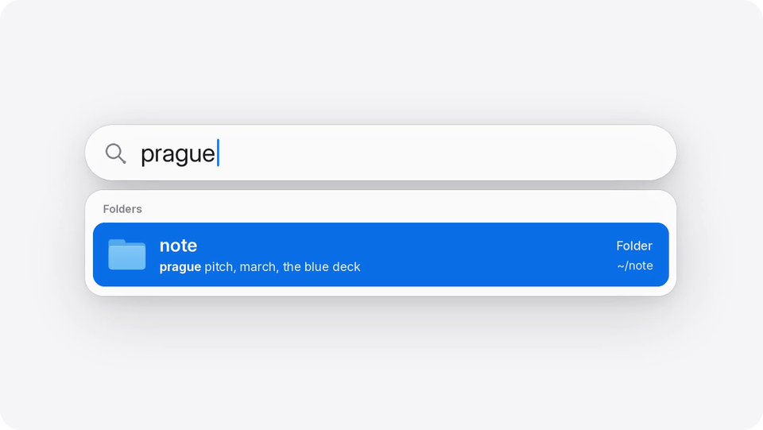

<p align="center">
  <picture>
    <source media="(prefers-color-scheme: dark)" srcset="assets/hero-dark.svg">
    <source media="(prefers-color-scheme: light)" srcset="assets/hero-light.svg">
    
  </picture>
</p>

<p align="center">
  <a href="assets/demo.mp4"></a>
  <br>
  <a href="assets/demo.mp4"><b>Watch the demo with sound →</b></a>
</p>

Your folders have names, but not memories. Tell a folder what's inside once, in your own words, and Spotlight hands it back the day you forget where it went.

<picture>
  <source media="(prefers-color-scheme: dark)" srcset="assets/steps-dark.svg">
  <source media="(prefers-color-scheme: light)" srcset="assets/steps-light.svg">
  
</picture>

```sh
cd ~/Projects/client-work
note prague pitch, march, the blue deck   # leave the note
note find prague                          # weeks later, from any folder
```

<p align="center">
  
  
</p>

## Install

```sh
git clone https://github.com/baiehclaca/note && cd note
cargo build --release && cp target/release/note ~/bin/note
```

macOS only for now. Windows and Linux: coming.

**How it works:** your words become the folder's Finder comment, Spotlight indexes it, and nothing is added inside the folder.

<sub><code>note</code> shows the note, <code>note clear</code> removes it. Notes hold up to 2048 bytes. Spotlight skips hidden folders and <code>/tmp</code>. <code>note -- clear</code> saves the word "clear".</sub>
